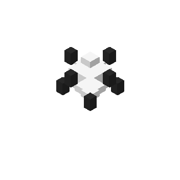
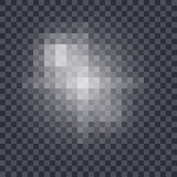

# New Mod

A **Fabric** mod for **Minecraft 26.3** that adds the **Black Block**, the pillar weapon **Black Block Star**, the **Obsidian Cube**, and a set of shape-summoning abilities built around black block pillars — collisions, black holes, mark-based barrages and two sneak skills.

> 中文说明见 [`README.zh_cn.md`](README.zh_cn.md)

<p align="center">
  
  <br>
  
  
</p>

## Requirements

- Minecraft **26.3**
- Fabric Loader **0.19.5** or newer
- Fabric API **0.161.0+26.3** or newer
- Java **25**

## Building

```bash
./gradlew build          # jar lands in build/libs/
./gradlew runClient      # launch a development client
./gradlew runDatagen     # regenerate data (headless)
```

## Assets

All textures, the item model and the mod icon are **generated by a script** — no image library and no third-party art:

```bash
node tools/gen-assets.js                    # regenerate textures, model and icon
node tools/gen-assets.js --preview <dir>    # also write magnified / isometric previews
node tools/check-assets.js                  # validate the generated assets
```

The how and why (hand-written PNG structure, voxel spheres, item-atlas rules, 26.3 model limitations) is documented in the generator's own comments. The images above are produced by `--preview` into `docs/preview/`.

## License

[MIT](LICENSE) © 2026 siza-h.

This mod is not affiliated with Mojang Studios or Microsoft. "Minecraft" is a trademark of Mojang Synergies AB; this project only links against the official game and Fabric APIs, and redistributes no Mojang assets.
